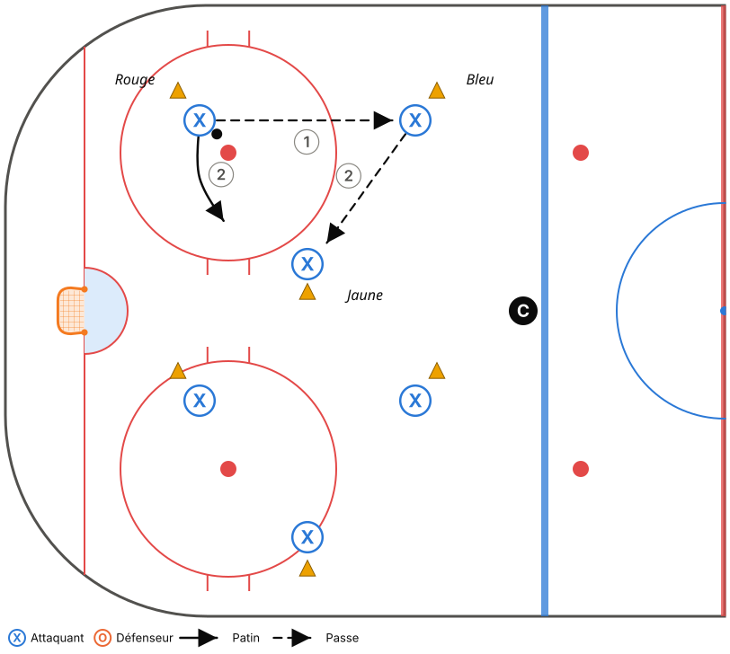
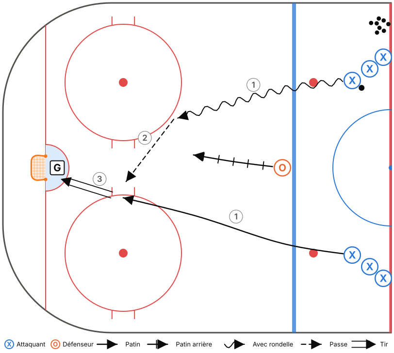

# M11-B – Semaine 1

**Thème :** Zone défensive : PRESSION – SOUTIEN – FILET  
**Glace :** Demi-glace, 50 min (45 min d'exercices + 5 min de consignes et transitions)

> Fiche générée à partir de `outils/modeles.js`. Pour la modifier, ouvre `outils/plan-pratique.html` et charge le modèle « M11-B – Semaine 1 ».

## Objectifs

- Introduire les rôles en zone défensive (phase 1).
- Tête sur l'épaule avant de toucher la rondelle.
- Lecture du 2c1 : « fais choisir le défenseur ».

## Tableau (vestiaire)

Vestiaire (3 min) : dessiner la zone défensive, les 4 rôles, et demander : « Pourquoi il faut toujours quelqu'un devant le filet? »

## Déroulement

| Heure | Code | Exercice | Catégorie | Min | Notes |
|---|---|---|---|---|---|
| 0:00–0:05 | T01 | Échauffement aux cercles – croisés avant et arrière | Technique | 5 | Demi-glace : 3 groupes (2 cercles + demi-cercle central). Rondelle au 2e tour. Le coach lève des doigts : les joueurs crient le nombre. |
| 0:05–0:11 | T13 | Passes à 3 avec décision (couleurs) | Technique | 6 | Commencer par 2 couleurs, puis 3. |
| 0:11–0:18 | T12 | Récupération derrière le filet – tête sur l'épaule | Technique | 7 | Tous les joueurs passent (pas seulement les D). Couleurs : bleu = MUR, rouge = MILIEU, blanc = REVERS. |
| 0:18–0:23 | T11 | Passe par la bande et réception au mur | Technique | 5 | L'ailier crie MUR! avant de recevoir. |
| 0:23–0:29 | TI03 | 2c1 – « Fais choisir le défenseur » | Tactique individuelle | 6 | Après chaque essai, demander au porteur : « Qu'est-ce que le D a fait? » |
| 0:29–0:34 | TI12 | Couverture de la pointe par l'ailier | Tactique individuelle | 5 | Enchaîner : l'interception → sortie le long du MUR. |
| 0:34–0:39 | TC05 | Zone défensive 5c0 dans l'ombre | Tactique collective | 5 | Ralenti seulement. Arrêts sur image : chaque joueur nomme son rôle. |
| 0:39–0:45 | TC11 | Petits jeux à règles (cross-ice) | Tactique collective | 6 | Règle : un but compte seulement si un joueur est devant le filet (FILET!). |

## Répartition du temps

| Catégorie | Minutes | % réel | Cible Hockey Québec |
|---|---|---|---|
| Technique | 23 | 51,1 % | 50 % ✓ |
| Tactique individuelle | 11 | 24,4 % | 25 % ✓ |
| Tactique collective | 11 | 24,4 % | 25 % ✓ |

## Détail des exercices

### T01 – Échauffement aux cercles – croisés avant et arrière

*Technique · Pleine glace*

**Objectif :** Réchauffer et travailler les croisés dans les deux sens.

**Organisation :** Un groupe par cercle (5 cercles). Aucune rondelle, puis avec rondelle.

> **Adaptation demi-glace :** Utiliser les 2 cercles de la zone et le demi-cercle central : 3 groupes au lieu de 5.

1. Croisés avant autour du cercle, 2 tours dans chaque sens.
2. Croisés arrière, 2 tours dans chaque sens.
3. Au sifflet, sprint vers le cercle suivant.
4. Reprendre avec rondelle.

**Points clés :** Genoux fléchis · Pousser avec le pied de l'extérieur ET le pied de l'intérieur · Tête haute

### T13 – Passes à 3 avec décision (couleurs)

*Technique · Demi-glace · Décisionnel (IQ)*

**Objectif :** Travailler la passe en ajoutant une décision rapide (IQ en contexte technique).

**Organisation :** Groupes de 3 dans un triangle de 3 cônes de couleur. Un joueur au centre.

1. Les 3 joueurs se passent la rondelle en se déplaçant d'un cône à l'autre.
2. Le coach crie une couleur : le porteur doit passer au joueur le plus près de ce cône.
3. Changer de rôle aux 45 s.

**Points clés :** Regarder AVANT de recevoir · Se déplacer vers un espace libre après sa passe · Passe à plat

### T12 – Récupération derrière le filet – tête sur l'épaule

*Technique · Zone · Décisionnel (IQ)*

**Objectif :** Récupérer une rondelle derrière le filet en regardant par-dessus l'épaule avant de la toucher.

**Organisation :** D à la ligne bleue. Coach au centre avec des rondelles. 3 cibles : MUR, MILIEU, REVERS (joueurs ou cônes).

1. Le coach lance la rondelle dans un coin ou derrière le filet.
2. Le D pivote, patine vers la rondelle et regarde par-dessus son épaule.
3. Pendant ce temps, le coach lève une couleur : le D doit passer à l'option correspondante.

**Points clés :** Tête sur l'épaule AVANT d'arriver à la rondelle · Ramasser la rondelle en mouvement · Passe ferme

### T11 – Passe par la bande et réception au mur

*Technique · Zone*

**Objectif :** Maîtriser la passe par la bande et la réception dos à la bande (sortie de zone).

**Organisation :** D derrière le filet avec des rondelles, ailiers sur la bande à la ligne des hachures.

1. Le D fait une passe (directe ou par la bande) à l'ailier au MUR.
2. L'ailier reçoit dos à la bande, pivote vers le haut et accélère le long de la bande jusqu'à la ligne rouge.
3. Les deux côtés en alternance.

**Points clés :** Ailier : dos à la bande, voir le jeu avant de recevoir · Passeur : viser la bande 1 m devant le receveur · Recevoir en protégeant la rondelle

### TI03 – 2c1 – « Fais choisir le défenseur »

*Tactique individuelle · Demi-glace · Décisionnel (IQ)*

**Objectif :** Lire le défenseur sur un 2c1 : s'il prend le porteur, on passe; s'il prend la passe, on tire.

**Organisation :** 2 files d'attaquants à la ligne rouge, un défenseur à la ligne bleue. Un gardien.

1. Les 2 attaquants partent avec une rondelle, le D recule.
2. Le porteur attaque le D. Le 2e attaquant va au filet.
3. Après chaque essai, le coach demande au porteur : « Qu'est-ce que le D a fait? »

**Points clés :** Porteur : attaquer le D pour le forcer à choisir · 2e attaquant : bâton sur la glace, va au filet · D : rester au centre, bâton dans la ligne de passe

### TI12 – Couverture de la pointe par l'ailier

*Tactique individuelle · Zone · Décisionnel (IQ)*

**Objectif :** L'ailier défensif doit voir la rondelle ET son joueur, et bloquer la ligne de passe vers la pointe.

**Organisation :** Coach dans le coin avec des rondelles, adversaire à la pointe, ailier en position de HAUTEUR.

1. Le coach essaie de passer à la pointe.
2. L'ailier coupe la ligne de passe avec son bâton ou se déplace pour bloquer le tir.
3. S'il intercepte, il part en sortie de zone le long du MUR.

**Points clés :** Position entre la pointe et l'enclave · Tête qui pivote : rondelle, joueur, rondelle · Partir dès que l'équipe récupère la rondelle

### TC05 – Zone défensive 5c0 dans l'ombre

*Tactique collective · Zone · Décisionnel (IQ)*

**Objectif :** Apprendre les positions en zone défensive selon l'emplacement de la rondelle.

**Organisation :** 5 joueurs en zone défensive. Le coach (ou 2 assistants) déplace la rondelle en zone (coins, bande, pointe, derrière le filet).

1. Le coach déplace lentement la rondelle. Les 5 joueurs s'ajustent sans contact.
2. Arrêt sur image : chaque joueur nomme son rôle (PRESSION, SOUTIEN, FILET, HAUTEUR).
3. Au sifflet, le coach lance la rondelle et l'équipe fait la sortie de zone.

**Points clés :** M11 : Pression – Soutien – Filet + 2 en hauteur · M15 : Boîte + 1, toujours un D au filet · Bâton sur la glace

### TC11 – Petits jeux à règles (cross-ice)

*Tactique collective · Tiers de glace · Décisionnel (IQ)*

**Objectif :** Beaucoup de touches de rondelle et de décisions, avec une règle qui renforce un principe du système.

**Organisation :** 3c3 ou 4c4 dans une zone (largeur de la patinoire), 2 filets. Changements de 45 s.

1. Choisir une règle selon la notion à travailler :
2. • But compte double si tous les joueurs ont touché la rondelle (soutien).
3. • But compte seulement si un joueur est devant le filet (FILET).
4. • Il faut ramener la rondelle au-delà d'une ligne de cônes après une récupération (transition / sortie de zone).
5. • M15 : but compte double sur un rebond.

**Points clés :** Le coach ne s'arrête pas pour expliquer : il pose des questions au banc · Changer de règle aux 3-4 min
