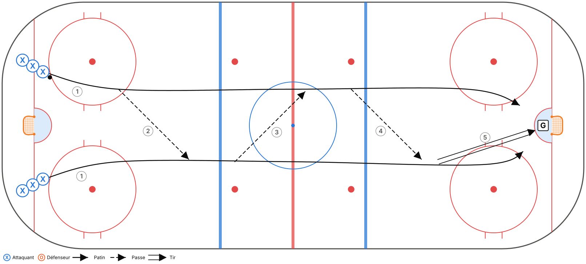
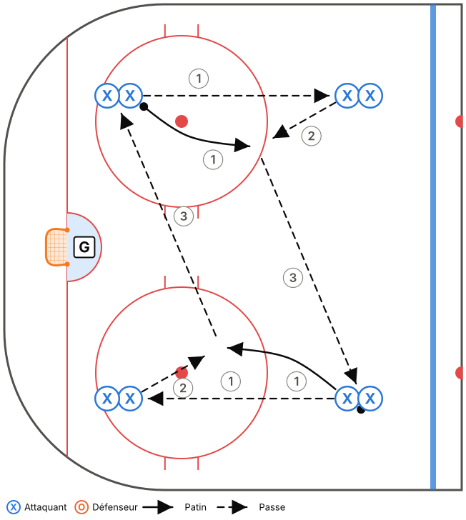
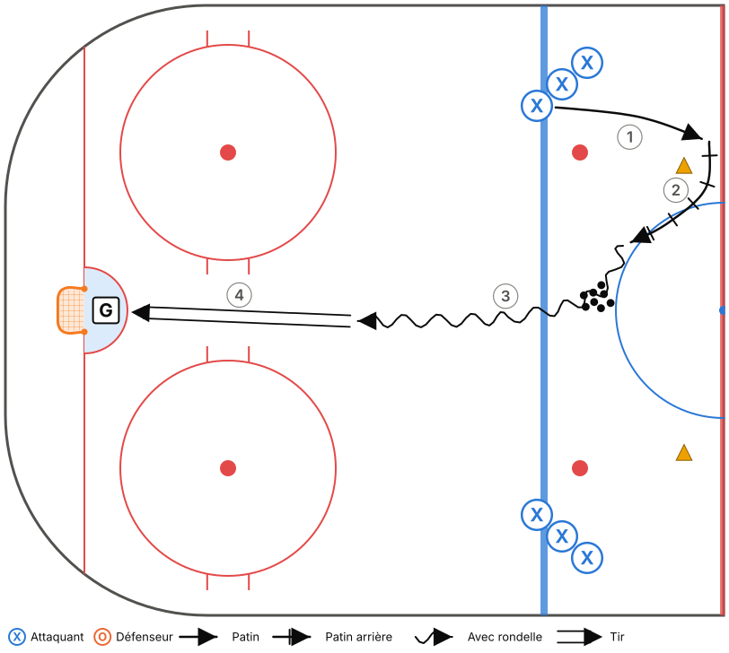
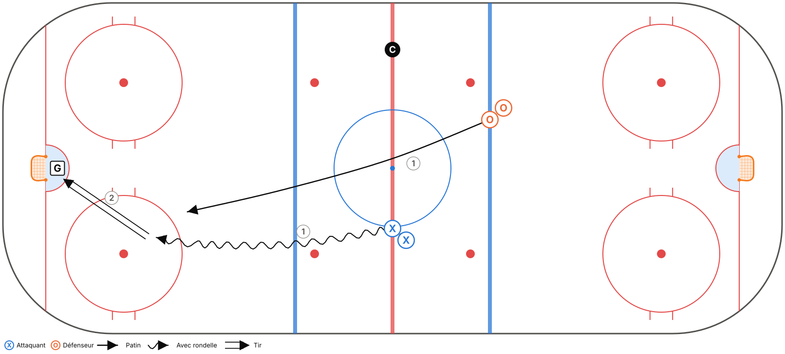

# M11-B – Semaine 2

**Thème :** Sortie de zone : MUR – MILIEU – REVERS  
**Glace :** Demi-glace, 50 min (45 min d'exercices + 5 min de consignes et transitions)

> Fiche générée à partir de `outils/modeles.js`. Pour la modifier, ouvre `outils/plan-pratique.html` et charge le modèle « M11-B – Semaine 2 ».

## Objectifs

- Introduire la sortie de zone (phase 1).
- Repli par le milieu.
- Rappel de la zone défensive (semaine 1).

## Tableau (vestiaire)

Vestiaire (3 min) : dessiner la sortie de zone, les 3 options et les 3 mots. Question : « Pourquoi jamais de passe au milieu de notre enclave? »

## Déroulement

| Heure | Code | Exercice | Catégorie | Min | Notes |
|---|---|---|---|---|---|
| 0:00–0:05 | T01 | Échauffement aux cercles – croisés avant et arrière | Technique | 5 | Demi-glace : 3 groupes. |
| 0:05–0:11 | T04 | Passes en mouvement – 2 lignes | Technique | 6 | Départ de la ligne rouge. 2e minute : passes du revers seulement. |
| 0:11–0:17 | T16 | Carré de passes (4 coins, 2 rondelles) | Technique | 6 | Passer à 2 rondelles rapidement. |
| 0:17–0:23 | T08 | Tir après pivot | Technique | 6 |  |
| 0:23–0:28 | TI06 | Repli 1c1 – rondelle, homme, filet | Tactique individuelle | 5 | Départ à la ligne rouge. Insister : revenir par le MILIEU, pas le long de la bande. |
| 0:28–0:34 | TI01 | 1c1 bande à bande – contrôle de l'écart | Tactique individuelle | 6 | Tout le monde joue les deux rôles (avants aussi en défense). |
| 0:34–0:40 | TC01 | Sortie de zone 5c0 – MUR, MILIEU, REVERS | Tactique collective | 6 | Sortie réussie à la ligne rouge, virage, puis attaque du même filet. Ralenti → vitesse. Au début, le coach annonce l'option. Ensuite, le D décide. |
| 0:40–0:45 | TC11 | Petits jeux à règles (cross-ice) | Tactique collective | 5 | Règle : après une récupération, la rondelle doit passer par un joueur au MUR avant un tir. |

## Répartition du temps

| Catégorie | Minutes | % réel | Cible Hockey Québec |
|---|---|---|---|
| Technique | 23 | 51,1 % | 50 % ✓ |
| Tactique individuelle | 11 | 24,4 % | 25 % ✓ |
| Tactique collective | 11 | 24,4 % | 25 % ✓ |

## Détail des exercices

### T01 – Échauffement aux cercles – croisés avant et arrière

*Technique · Pleine glace*

**Objectif :** Réchauffer et travailler les croisés dans les deux sens.

**Organisation :** Un groupe par cercle (5 cercles). Aucune rondelle, puis avec rondelle.

> **Adaptation demi-glace :** Utiliser les 2 cercles de la zone et le demi-cercle central : 3 groupes au lieu de 5.

1. Croisés avant autour du cercle, 2 tours dans chaque sens.
2. Croisés arrière, 2 tours dans chaque sens.
3. Au sifflet, sprint vers le cercle suivant.
4. Reprendre avec rondelle.

**Points clés :** Genoux fléchis · Pousser avec le pied de l'extérieur ET le pied de l'intérieur · Tête haute

### T04 – Passes en mouvement – 2 lignes

*Technique · Pleine glace*

**Objectif :** Passes et réceptions en patinant, du coup droit et du revers.

**Organisation :** 2 lignes sur la ligne des buts, une de chaque côté. Les paires partent ensemble.

> **Adaptation demi-glace :** Partir de la ligne rouge, passes jusqu'au filet, tir. Retour le long de la bande jusqu'à la ligne rouge.

1. Les 2 joueurs patinent en parallèle (environ 5 m d'écart) et échangent la rondelle jusqu'à l'autre bout.
2. Tir au but à la fin, les 2 joueurs vont au filet.
3. Retour par la bande.

**Points clés :** Passer DEVANT le receveur (dans sa trajectoire) · Recevoir avec la palette « molle » · Garder la vitesse

### T16 – Carré de passes (4 coins, 2 rondelles)

*Technique · Zone*

**Objectif :** Passes en mouvement et réception à haute vitesse, beaucoup de répétitions.

**Organisation :** 4 files dans les 4 coins d'un carré (zone). 2 rondelles partent en même temps de coins opposés.

1. Le joueur passe à la file suivante (sens horaire), puis patine vers cette file.
2. Il reçoit une remise et la passe au coin suivant.
3. Changer de sens après 1 minute.

**Points clés :** Passe devant le receveur · Recevoir en patinant · Communiquer

### T08 – Tir après pivot

*Technique · Demi-glace*

**Objectif :** Tirer rapidement après un changement de direction.

**Organisation :** 2 files à la ligne bleue. Des rondelles au centre. Un gardien.

1. Le joueur patine vers la ligne rouge, pivote vers l'arrière autour d'un cône, puis pivote vers l'avant.
2. Il récupère une rondelle (ou reçoit une passe du coach) et tire en mouvement.
3. Il va au rebond.

**Points clés :** Tirer sans ralentir · Viser les coins bas · Toujours suivre son tir

### TI06 – Repli 1c1 – rondelle, homme, filet

*Tactique individuelle · Pleine glace · Décisionnel (IQ)*

**Objectif :** Revenir en défense par le milieu et se placer entre son adversaire et le filet.

**Organisation :** Attaquant avec rondelle à la ligne rouge, défenseur (un avant) à la ligne bleue adverse qui doit revenir.

> **Adaptation demi-glace :** L'attaquant part de la ligne rouge. L'avant en repli part aussi de la ligne rouge, 2-3 m derrière, et revient par le milieu.

1. Au sifflet, l'attaquant attaque, l'avant revient par le milieu.
2. Variante : l'attaquant fait une passe à un 2e joueur, et l'avant doit couvrir le joueur sans rondelle.

**Points clés :** Revenir par le MILIEU · Tête sur l'épaule · Bâton dans la ligne de passe

### TI01 – 1c1 bande à bande – contrôle de l'écart

*Tactique individuelle · Demi-glace · Décisionnel (IQ)*

**Objectif :** Défenseur : garder l'écart et pousser à l'extérieur. Attaquant : battre le défenseur.

**Organisation :** Attaquants dans le coin, défenseurs à la ligne bleue. Un gardien.

1. L'attaquant part avec la rondelle, le défenseur recule en patin arrière.
2. Le défenseur garde environ 2 bâtons d'écart, puis ferme l'écart en poussant l'attaquant vers la bande.
3. L'attaquant cherche à entrer au centre ou à tirer.

**Points clés :** D : bâton sur la glace, corps entre l'attaquant et le filet · Attaquant : changer de vitesse · Écart constant

### TC01 – Sortie de zone 5c0 – MUR, MILIEU, REVERS

*Tactique collective · Pleine glace · Décisionnel (IQ)*

**Objectif :** Apprendre les positions et les options de la sortie de zone.

**Organisation :** 5 joueurs en position de zone défensive. Le coach lance la rondelle dans un coin ou derrière le filet.

> **Adaptation demi-glace :** La sortie est réussie quand la rondelle franchit la ligne rouge. Les 5 font un virage à la ligne rouge et reviennent attaquer le même filet (sortie + attaque dans la même demi-glace).

1. Le D récupère. Les ailiers partent au MUR, le centre au MILIEU, l'autre D au REVERS.
2. Le D choisit une option (au début, c'est le coach qui l'annonce, ensuite le D décide).
3. Les 5 montent ensemble et l'attaque se termine par un tir.
4. Ralenti → vitesse réelle.

**Points clés :** Chacun CRIE son option · Monter à 5, en 2 zones maximum · M15 : si le coach crie HOMME, on sort sur la VITRE

### TC11 – Petits jeux à règles (cross-ice)

*Tactique collective · Tiers de glace · Décisionnel (IQ)*

**Objectif :** Beaucoup de touches de rondelle et de décisions, avec une règle qui renforce un principe du système.

**Organisation :** 3c3 ou 4c4 dans une zone (largeur de la patinoire), 2 filets. Changements de 45 s.

1. Choisir une règle selon la notion à travailler :
2. • But compte double si tous les joueurs ont touché la rondelle (soutien).
3. • But compte seulement si un joueur est devant le filet (FILET).
4. • Il faut ramener la rondelle au-delà d'une ligne de cônes après une récupération (transition / sortie de zone).
5. • M15 : but compte double sur un rebond.

**Points clés :** Le coach ne s'arrête pas pour expliquer : il pose des questions au banc · Changer de règle aux 3-4 min
