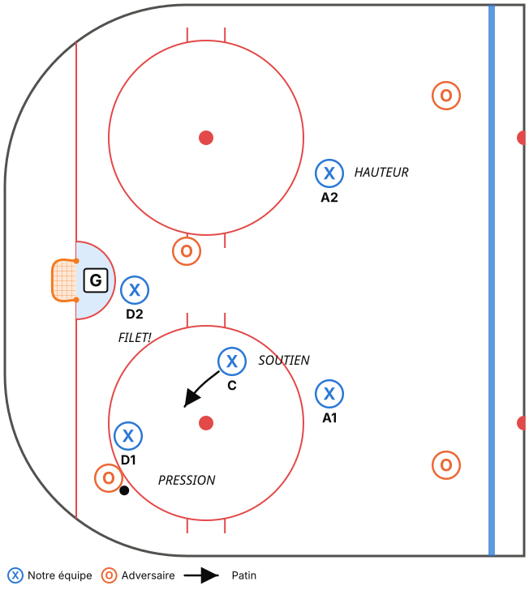
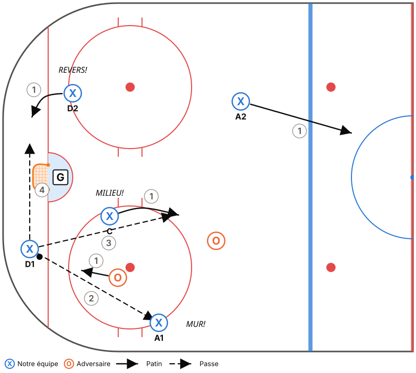
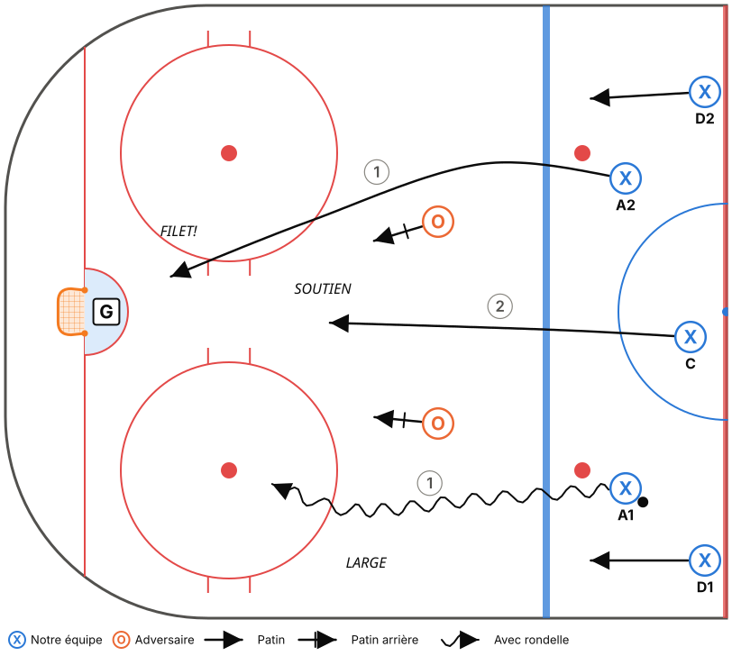
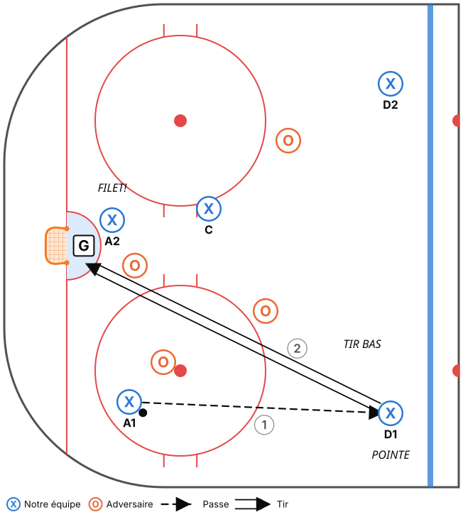
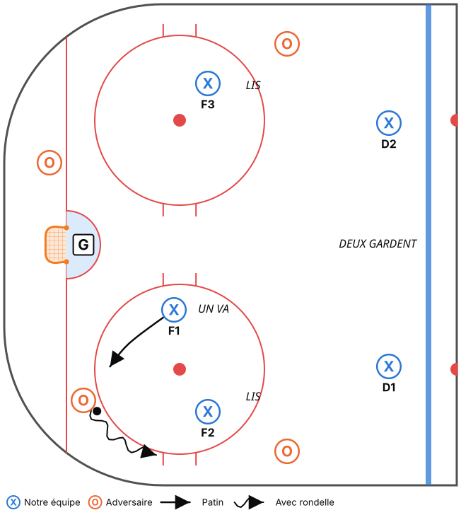
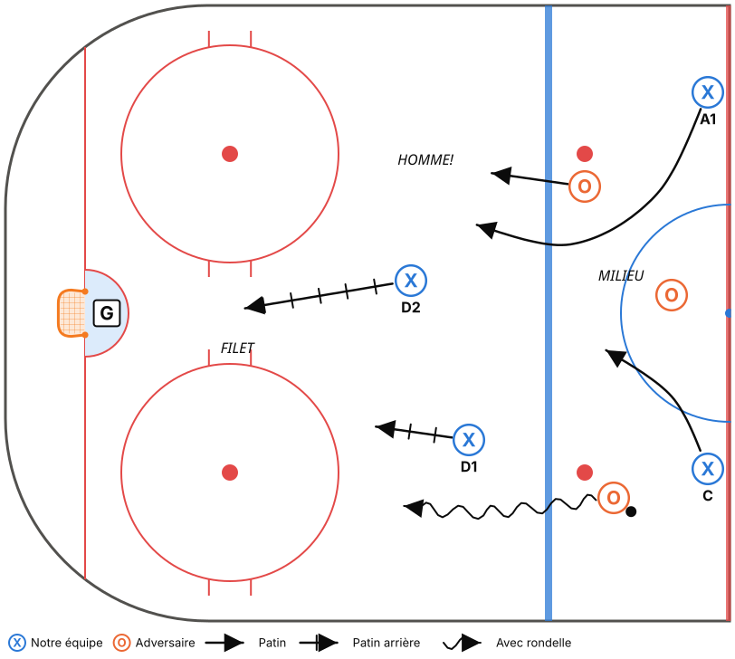
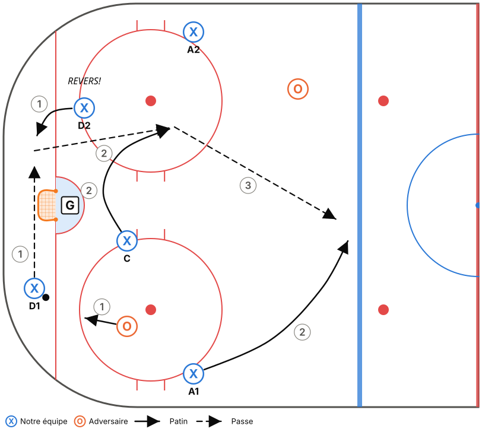
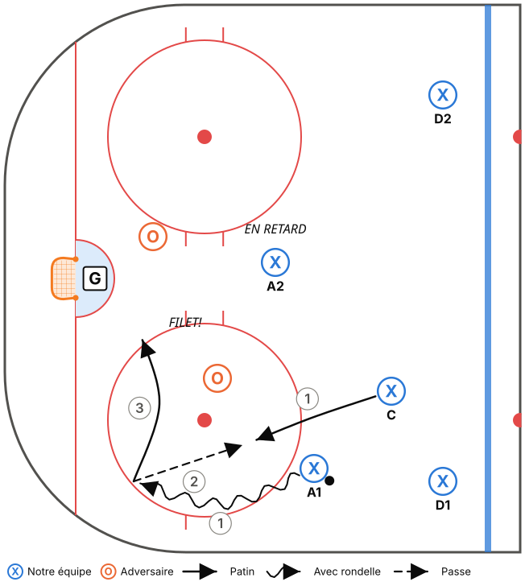
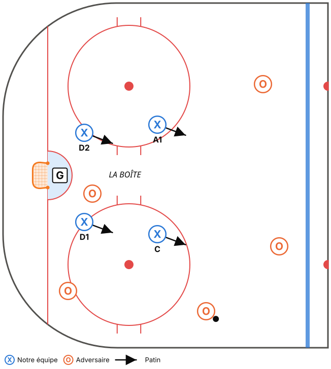

# Système de jeu – M11-B

## Philosophie

Les joueurs ont déjà une bonne technique. Ce qui leur manque, c'est **savoir quoi faire avec**. Le système sert donc à apprendre à **lire le jeu**, pas à placer des pions.

- **Des principes plutôt que des positions fixes.** En phase 1, chaque joueur a un rôle précis pour sécuriser la cohésion. On passe ensuite à des **rôles selon la proximité** (« le plus près va »), ce qui oblige à lire le jeu.
- **3 mots par situation.** Chaque situation de jeu tient en 3 mots-clés que les joueurs crient sur la glace. Si un joueur de 10 ans ne peut pas l'expliquer en 10 secondes, c'est trop compliqué.
- **Poser des questions plutôt que donner des réponses.** Au banc et en pratique : « Qu'est-ce que tu as vu? Quelle autre option tu avais? »

> Rappel M11 : la mise en échec corporelle est interdite. On enseigne l'**angle**, le **bâton sur la glace** et le **contact de positionnement** (se placer entre l'adversaire et le filet).

---

## Vocabulaire commun (à afficher dans le vestiaire)

| Mot-clé | Qui le crie | Signification |
|---|---|---|
| **MUR!** | Ailier sur la bande | « Je suis ton option sur la bande. » |
| **MILIEU!** | Centre en soutien | « Je suis au centre, passe-moi. » |
| **REVERS!** | Défenseur opposé | « Envoie-la de l'autre côté / derrière. » |
| **TEMPS!** | N'importe qui | « Personne sur toi, prends ton temps. » |
| **HOMME!** | N'importe qui | « Pression, joue vite! » |
| **FILET!** | Joueur devant le filet | « Je suis au filet, tire ou passe-moi. » |
| **J'Y VAIS!** | Joueur qui fait pression | « Je prends le porteur. » (phase 2) |
| **JE COUVRE!** | Joueur qui remplace | « Je prends ta place. » (phase 2-3) |

---

## PHASE 1 – Les fondations (fin sept. à fin nov.)

Objectif : **tout le monde sait où aller dans les 5 situations de base.**

### 1. Zone défensive : « PRESSION – SOUTIEN – FILET »

| Joueur | Rôle | Règle simple |
|---|---|---|
| **D1** (côté rondelle) | **PRESSION** | Corps entre le porteur et le filet, bâton sur la palette. |
| **C** | **SOUTIEN** | Aide D1 et récupère la rondelle libre. Ne dépasse jamais le filet vers le côté faible. |
| **D2** | **FILET** | Devant le filet, surveille le joueur le plus dangereux, bâton sur la glace. |
| **Ailiers** | **HAUTEUR** | Entre la pointe et l'enclave. On regarde la rondelle ET son joueur (« tête sur un pivot »). |

**Règle d'or :** quand on récupère la rondelle, les ailiers **partent au mur** (sortie de zone).

### 2. Sortie de zone : « MUR – MILIEU – REVERS »

- **D1** : récupère la rondelle.
- **A1 (MUR)** : dos à la bande, à la hauteur des hachures.
- **C (MILIEU)** : bas, au centre, en mouvement.
- **D2 (REVERS)** : de l'autre côté du filet.
- **A2** : au milieu, en haut de la zone.

1. **D1** regarde par-dessus son épaule **avant** d'arriver à la rondelle.
2. Il écoute et choisit entre **MUR** (ailier), **MILIEU** (centre) et **REVERS** (D2 de l'autre côté).
3. **Personne libre?** On envoie la rondelle **le long de la bande ou sur la vitre**. **Jamais** de passe au milieu de notre enclave.
4. Après la passe, **tout le monde monte ensemble** (5 joueurs dans 2 zones).

### 3. Attaque et entrée de zone : « LARGE – FILET – SOUTIEN »

- **Le porteur** entre en vitesse (en largeur si un D l'attend).
- **Le 2e avant** va **au filet** (toujours!).
- **Le 3e avant** arrive **en retard, au haut de l'enclave** (soutien et rebond).
- **Les D** montent jusqu'à la ligne rouge, puis gardent la ligne bleue offensive.

**Lecture 2 contre 1 (introduite dès la phase 1) :** « **Fais choisir le défenseur.** » S'il prend le porteur, on passe. S'il prend la passe, on tire ou on va au filet.

### 4. Zone offensive : « TIRE – FILET – POINTE »

- Il y a **toujours** un joueur **devant le filet**.
- Si tu n'as pas d'ouverture, remets la rondelle à la **pointe** (D), qui tire **bas**.
- Tous les tirs doivent rester **bas**, pour créer des rebonds.

### 5. Échec avant 1-2-2 : « UN VA, DEUX LISENT, DEUX GARDENT »

- **F1** force le porteur vers la bande, **jamais vers le milieu**.
- **F2 / F3** interceptent la passe le long de la bande de leur côté.
- **D1 / D2** gardent la ligne bleue. En cas de doute, **on recule**.

### 6. Repli défensif : « MILIEU – HOMME – FILET »

- Les avants reviennent **par le milieu** de la patinoire (pas le long de la bande).
- Ils prennent **un joueur sans rondelle** et restent entre lui et **notre filet**.
- Les D s'occupent du porteur (écart de 2 bâtons, bâton sur la glace).

### Critères pour passer à la phase 2

- [ ] Sur un 5c0 dicté par le coach, tout le monde prend la bonne position en moins de 3 secondes.
- [ ] En match, on réussit au moins **6 sorties de zone sur 10** sans perdre la rondelle dans notre enclave.
- [ ] On entend les mots-clés sur la glace sans avoir à les demander.
- [ ] Les avants reviennent par le milieu en repli.

---

## PHASE 2 – Lire et échanger (déc. à fin jan.)

Objectif : **passer des positions fixes aux rôles selon la proximité.** C'est ici qu'on développe vraiment le hockey IQ.

### Zone défensive : « LE PLUS PRÈS VA »

- Le joueur **le plus près** du porteur fait la **PRESSION**, qu'il soit D ou avant.
- Le 2e plus près fait le **SOUTIEN**, le 3e prend le **FILET**.
- Les 2 autres montent en **HAUTEUR**.
- Communication obligatoire : « **J'Y VAIS!** » / « **JE COUVRE!** ».

### Sortie de zone : ajout du changement de côté

- **D1 → D2 derrière le filet** (« REVERS! ») quand la pression vient du côté fort.
- Le **centre fait une courbe** pour recevoir la passe en mouvement (au lieu d'attendre immobile).
- L'**ailier du côté faible** coupe au centre, à la ligne bleue, pour recevoir une passe d'étirement.

### Attaque : lecture 3 contre 2 et cycle simple

- **3c2 en triangle** : le porteur, un joueur au filet et un joueur en retard. « **Qui est libre?** »
- **Passe et va** : après une passe, on se déplace vers une ouverture. On ne reste jamais immobile.
- **Cycle simple** : le porteur descend dans le coin, remet la rondelle au joueur qui le suit, puis va au filet.

### Échec avant : 1-2-2 avec réaction

- Si F1 arrive **en premier** dans le coin et que l'adversaire est pris, **F2 embarque** (« J'Y VAIS! »). F3 prend le milieu.

### Unités spéciales (introduction)

- **Désavantage numérique : la boîte.** 4 joueurs en carré, bâtons dans les lignes de passe, on se déplace ensemble vers la rondelle.
- **Avantage numérique : 1 au filet et 2 tireurs.** Rondelle à la pointe, tir bas, un écran devant le gardien et un joueur aux rebonds.

### Critères pour passer à la phase 3

- [ ] En zone défensive, un avant et un D échangent leurs rôles sans confusion (au moins 1 fois par match).
- [ ] Sur un 2c1 ou 3c2 en pratique, le porteur fait le bon choix au moins 7 fois sur 10.
- [ ] Les joueurs expliquent au banc ce qu'ils ont vu (« le D l'a pris, j'aurais dû passer »).

---

## PHASE 3 – Autonomie (fév. à mars)

Objectif : **les joueurs ajustent eux-mêmes leur jeu pendant le match.**

- **Couvrir un D qui monte** : si un défenseur plonge dans la zone offensive, l'avant le plus haut prend sa place à la pointe (« JE COUVRE! »).
- **Lire l'adversaire** : entre deux périodes, on demande aux joueurs : « Par où sortent-ils de leur zone? Quel joueur est dangereux? »
- **Gestion de match** : quand on mène en fin de match, rondelle profonde et aucun risque à la ligne bleue. Quand on tire de l'arrière, échec avant plus agressif.
- **Transition rapide** : dès qu'on récupère la rondelle, les ailiers cherchent la profondeur (contre-attaque).

---

## Comment enseigner chaque nouvelle notion (même séquence à chaque fois)

1. **Tableau** (vestiaire, 3 min max) : dessine la situation, dis les 3 mots-clés et pose une seule question.
2. **5c0 au ralenti** : les joueurs marchent le système sur la glace. Le coach déplace la rondelle, les joueurs réagissent.
3. **5c0 à vitesse réelle**.
4. **Opposition passive** (bâton à l'envers ou 50 % de l'intensité).
5. **Opposition réelle** en situation (2c1, 3c2, 5c5 en zone).
6. **Petit jeu à règle** qui récompense le principe (ex. : un but compte double après une sortie réussie par MUR-MILIEU-REVERS).

> Les notions de la banque d'exercices marquées **Système M11 – Phase X** suivent cette séquence.

### Enseigner le système en demi-glace

Tout le système s'enseigne dans une seule zone et la zone neutre jusqu'à la ligne rouge :

| Situation | Comment la faire en demi-glace |
|---|---|
| Zone défensive, zone offensive, échec avant | Dans la zone, telle quelle. |
| Sortie de zone | Réussie quand la rondelle **franchit la ligne rouge**. Les 5 font ensuite un virage et attaquent le même filet. |
| Attaque / entrée de zone | Départ à la ligne rouge ou après un virage autour du demi-cercle central. |
| Repli | Les attaquants et les joueurs en repli partent de la ligne rouge, les joueurs en repli 2-3 m derrière. |
| Transition | Règle « on ressort » : après une récupération, il faut ressortir la rondelle au-delà de la ligne bleue avant d'attaquer. |

Ce qui manque en demi-glace, c'est la **vitesse et la distance** de la pleine glace (longues remontées, repli de 60 m). Les matchs servent donc de laboratoire : un objectif de match par semaine et, si possible, un parent qui filme.
