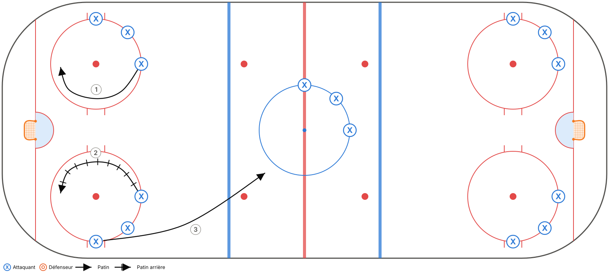
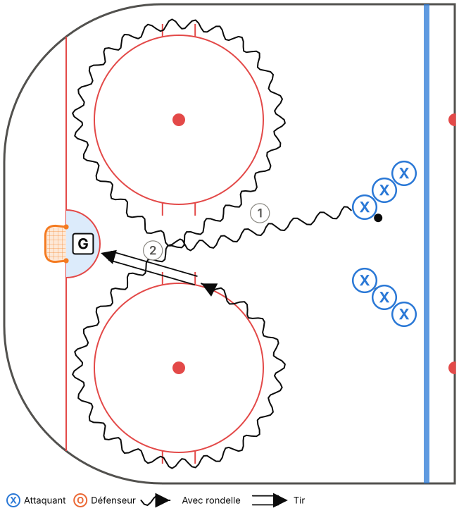
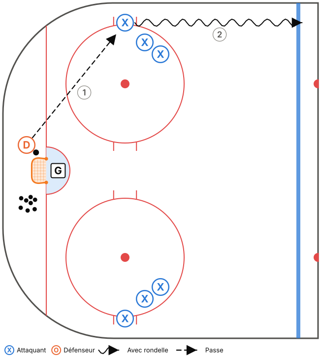
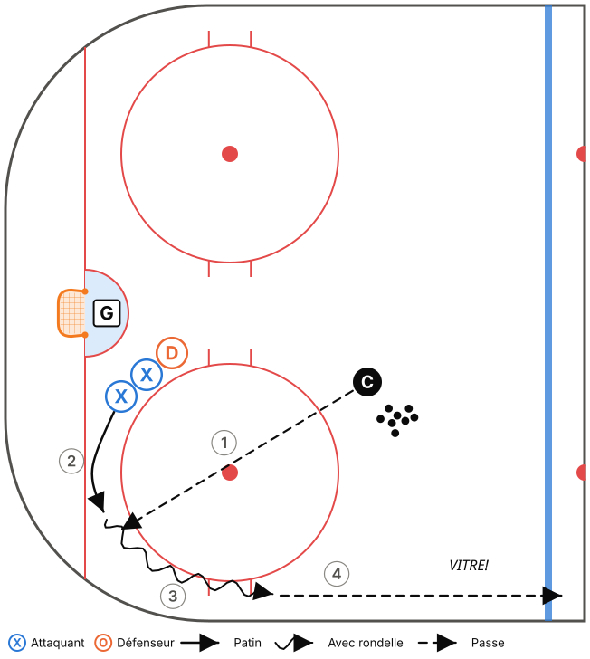
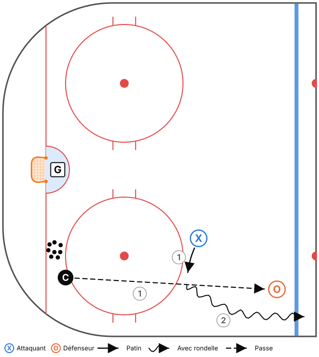
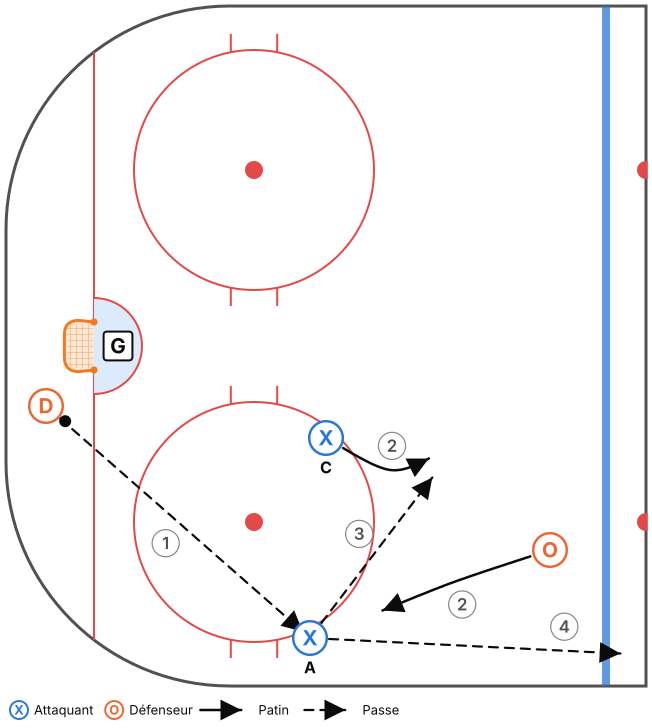
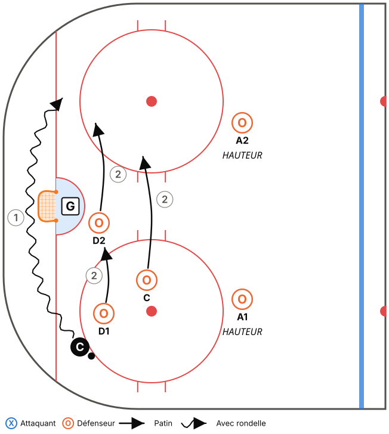
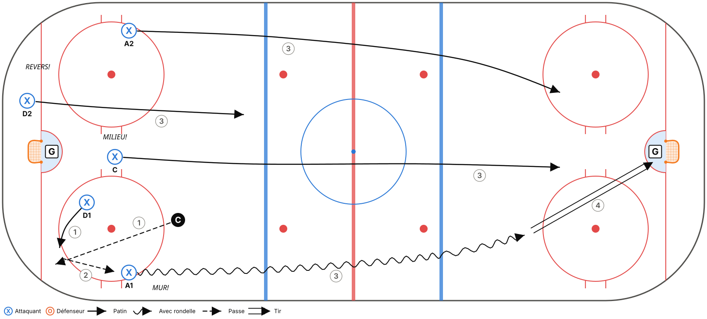
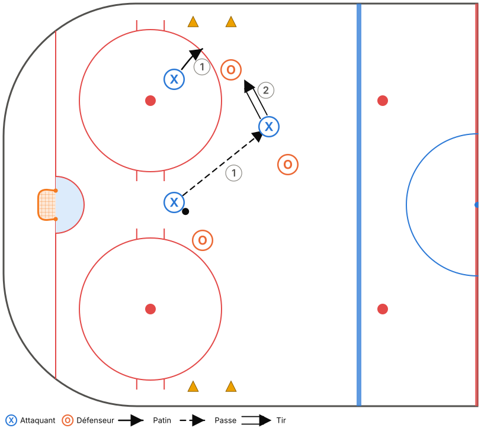

# M15-C – Semaine 1

**Thème :** Zone défensive : BOÎTE + 1  
**Glace :** Pleine glace, 50 min (45 min d'exercices + 5 min de consignes et transitions)

> Fiche générée à partir de `outils/modeles.js`. Pour la modifier, ouvre `outils/plan-pratique.html` et charge le modèle « M15-C – Semaine 1 ».

## Objectifs

- Introduire la zone défensive Boîte + 1 (phase 1).
- Options de sortie : MUR et VITRE.
- Réception au mur et patin avec rondelle.

## Tableau (vestiaire)

Vestiaire (3 min) : Boîte + 1, les 4 règles. Question : « Quand est-ce que VITRE est le meilleur jeu? »

## Déroulement

| Heure | Code | Exercice | Catégorie | Min | Notes |
|---|---|---|---|---|---|
| 0:00–0:04 | T01 | Échauffement aux cercles – croisés avant et arrière | Technique | 4 |  |
| 0:04–0:08 | T18 | Huit avec accélération et rondelle | Technique | 4 | Insister sur les croisés AVEC la rondelle. |
| 0:08–0:12 | T11 | Passe par la bande et réception au mur | Technique | 4 |  |
| 0:12–0:16 | T19 | Vitre et dehors (dégagement contrôlé) | Technique | 4 | Coup droit, puis revers. |
| 0:16–0:22 | TI12 | Couverture de la pointe par l'ailier | Tactique individuelle | 6 |  |
| 0:22–0:29 | TI09 | Ailier au mur sous pression – garder, pousser ou passer | Tactique individuelle | 7 | Féliciter la bonne décision, même si le geste rate. |
| 0:29–0:35 | TC05 | Zone défensive 5c0 dans l'ombre | Tactique collective | 6 | Boîte + 1. Vérifier à chaque arrêt : il y a un D au filet? |
| 0:35–0:40 | TC01 | Sortie de zone 5c0 – MUR, MILIEU, REVERS | Tactique collective | 5 | Le coach crie HOMME : on sort sur la VITRE. |
| 0:40–0:45 | TC11 | Petits jeux à règles (cross-ice) | Tactique collective | 5 | Règle : un but compte double sur un rebond. |

## Répartition du temps

| Catégorie | Minutes | % réel | Cible Hockey Québec |
|---|---|---|---|
| Technique | 16 | 35,6 % | 35 % ✓ |
| Tactique individuelle | 13 | 28,9 % | 30 % ✓ |
| Tactique collective | 16 | 35,6 % | 35 % ✓ |

## Détail des exercices

### T01 – Échauffement aux cercles – croisés avant et arrière

*Technique · Pleine glace*

**Objectif :** Réchauffer et travailler les croisés dans les deux sens.

**Organisation :** Un groupe par cercle (5 cercles). Aucune rondelle, puis avec rondelle.

1. Croisés avant autour du cercle, 2 tours dans chaque sens.
2. Croisés arrière, 2 tours dans chaque sens.
3. Au sifflet, sprint vers le cercle suivant.
4. Reprendre avec rondelle.

**Points clés :** Genoux fléchis · Pousser avec le pied de l'extérieur ET le pied de l'intérieur · Tête haute

### T18 – Huit avec accélération et rondelle

*Technique · Zone*

**Objectif :** Croisés et virages des deux côtés avec rondelle (point faible des M15-C).

**Organisation :** Autour des 2 cercles d'une zone. 2 files.

1. Le joueur fait un 8 autour des 2 cercles avec la rondelle.
2. À la sortie du 8, sprint vers le filet et tir.

**Points clés :** Croisés même avec la rondelle · Garder la rondelle du côté intérieur · Accélérer à la sortie du virage

### T11 – Passe par la bande et réception au mur

*Technique · Zone*

**Objectif :** Maîtriser la passe par la bande et la réception dos à la bande (sortie de zone).

**Organisation :** D derrière le filet avec des rondelles, ailiers sur la bande à la ligne des hachures.

1. Le D fait une passe (directe ou par la bande) à l'ailier au MUR.
2. L'ailier reçoit dos à la bande, pivote vers le haut et accélère le long de la bande jusqu'à la ligne rouge.
3. Les deux côtés en alternance.

**Points clés :** Ailier : dos à la bande, voir le jeu avant de recevoir · Passeur : viser la bande 1 m devant le receveur · Recevoir en protégeant la rondelle

### T19 – Vitre et dehors (dégagement contrôlé)

*Technique · Zone*

**Objectif :** Maîtriser le dégagement sur la vitre, l'option sécuritaire sous pression.

**Organisation :** D et ailiers dans le coin. Coach lance des rondelles.

1. Le joueur récupère la rondelle le long de la bande.
2. Il la soulève sur la vitre pour qu'elle sorte de la zone (sans dégagement refusé).
3. Alterner coup droit et revers.

**Points clés :** Palette ouverte, geste court · Viser la vitre juste au-dessus de la bande · Crier VITRE!

### TI12 – Couverture de la pointe par l'ailier

*Tactique individuelle · Zone · Décisionnel (IQ)*

**Objectif :** L'ailier défensif doit voir la rondelle ET son joueur, et bloquer la ligne de passe vers la pointe.

**Organisation :** Coach dans le coin avec des rondelles, adversaire à la pointe, ailier en position de HAUTEUR.

1. Le coach essaie de passer à la pointe.
2. L'ailier coupe la ligne de passe avec son bâton ou se déplace pour bloquer le tir.
3. S'il intercepte, il part en sortie de zone le long du MUR.

**Points clés :** Position entre la pointe et l'enclave · Tête qui pivote : rondelle, joueur, rondelle · Partir dès que l'équipe récupère la rondelle

### TI09 – Ailier au mur sous pression – garder, pousser ou passer

*Tactique individuelle · Zone · Décisionnel (IQ)*

**Objectif :** L'ailier qui reçoit au mur choisit selon la pression : garder et passer, pousser en neutre, ou sortir sur la vitre.

**Organisation :** D derrière le filet, ailier au mur, un défenseur adverse à la pointe. Un centre en soutien.

1. Le D passe à l'ailier au mur.
2. Le défenseur adverse attaque (ou pas) l'ailier, qui lit et décide.
3. Pas de pression : il sort avec la rondelle. Pression modérée : passe au centre. Forte pression : il pousse la rondelle en neutre ou sur la vitre.

**Points clés :** Regarder AVANT de recevoir · Une sortie de zone vaut mieux qu'une belle passe ratée · Crier les options (MILIEU!)

### TC05 – Zone défensive 5c0 dans l'ombre

*Tactique collective · Zone · Décisionnel (IQ)*

**Objectif :** Apprendre les positions en zone défensive selon l'emplacement de la rondelle.

**Organisation :** 5 joueurs en zone défensive. Le coach (ou 2 assistants) déplace la rondelle en zone (coins, bande, pointe, derrière le filet).

1. Le coach déplace lentement la rondelle. Les 5 joueurs s'ajustent sans contact.
2. Arrêt sur image : chaque joueur nomme son rôle (PRESSION, SOUTIEN, FILET, HAUTEUR).
3. Au sifflet, le coach lance la rondelle et l'équipe fait la sortie de zone.

**Points clés :** M11 : Pression – Soutien – Filet + 2 en hauteur · M15 : Boîte + 1, toujours un D au filet · Bâton sur la glace

### TC01 – Sortie de zone 5c0 – MUR, MILIEU, REVERS

*Tactique collective · Pleine glace · Décisionnel (IQ)*

**Objectif :** Apprendre les positions et les options de la sortie de zone.

**Organisation :** 5 joueurs en position de zone défensive. Le coach lance la rondelle dans un coin ou derrière le filet.

1. Le D récupère. Les ailiers partent au MUR, le centre au MILIEU, l'autre D au REVERS.
2. Le D choisit une option (au début, c'est le coach qui l'annonce, ensuite le D décide).
3. Les 5 montent ensemble et l'attaque se termine par un tir.
4. Ralenti → vitesse réelle.

**Points clés :** Chacun CRIE son option · Monter à 5, en 2 zones maximum · M15 : si le coach crie HOMME, on sort sur la VITRE

### TC11 – Petits jeux à règles (cross-ice)

*Tactique collective · Tiers de glace · Décisionnel (IQ)*

**Objectif :** Beaucoup de touches de rondelle et de décisions, avec une règle qui renforce un principe du système.

**Organisation :** 3c3 ou 4c4 dans une zone (largeur de la patinoire), 2 filets. Changements de 45 s.

1. Choisir une règle selon la notion à travailler :
2. • But compte double si tous les joueurs ont touché la rondelle (soutien).
3. • But compte seulement si un joueur est devant le filet (FILET).
4. • Il faut ramener la rondelle au-delà d'une ligne de cônes après une récupération (transition / sortie de zone).
5. • M15 : but compte double sur un rebond.

**Points clés :** Le coach ne s'arrête pas pour expliquer : il pose des questions au banc · Changer de règle aux 3-4 min
