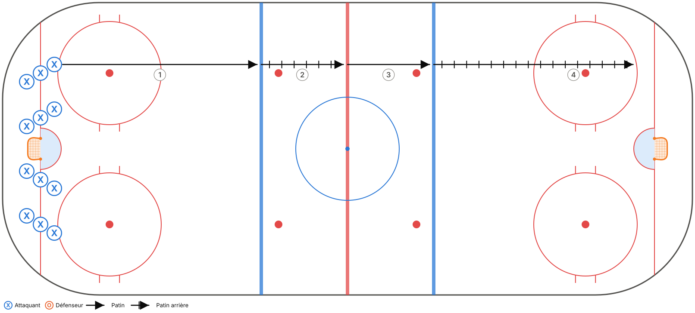
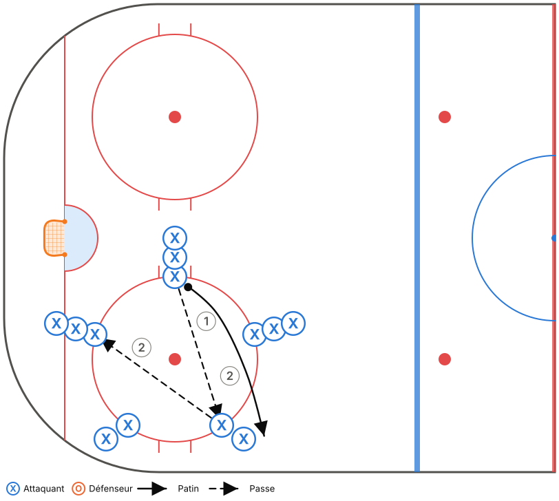
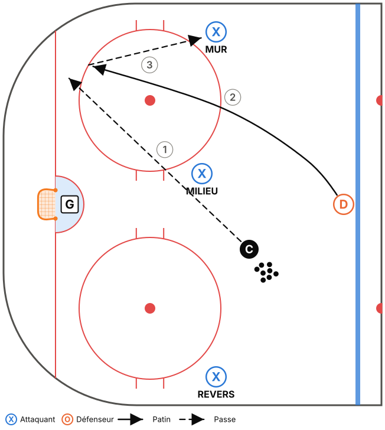
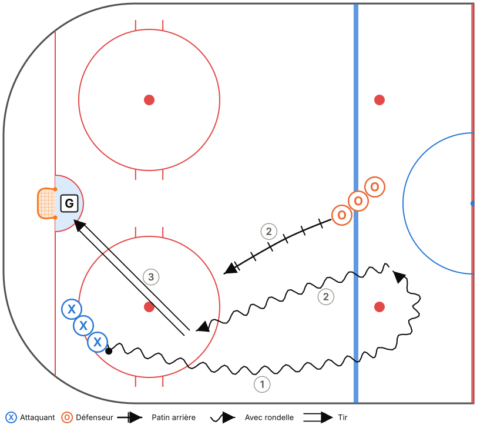
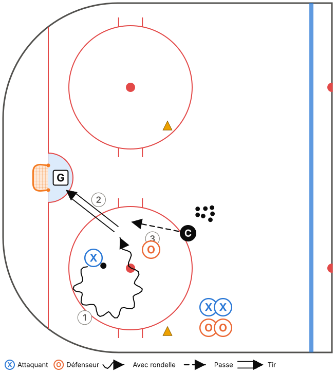
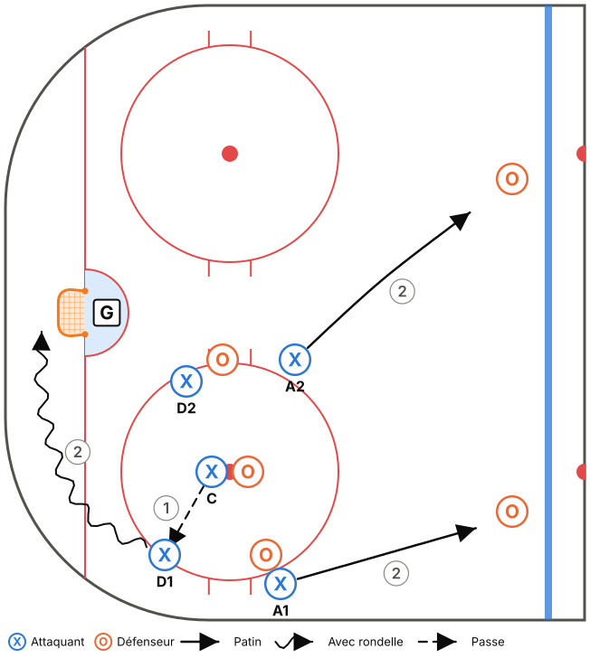
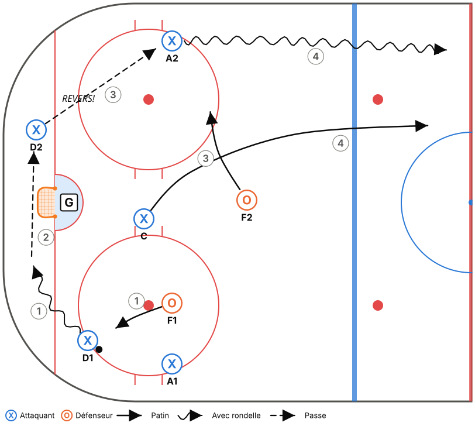
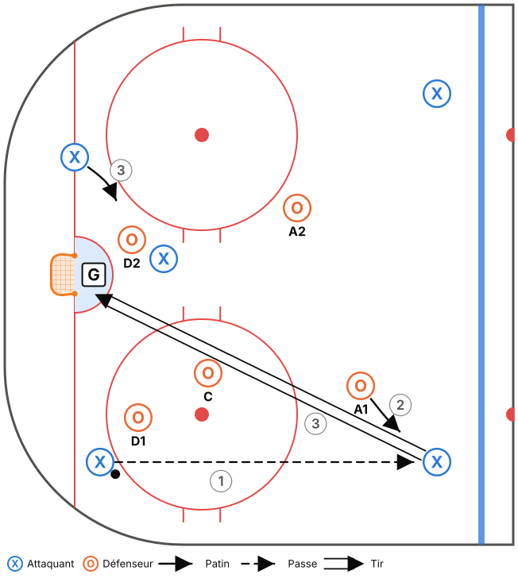

# M15-C – Semaine 2

**Thème :** Sortie de zone sous pression et mises au jeu  
**Glace :** Pleine glace, 50 min (45 min d'exercices + 5 min de consignes et transitions)

> Fiche générée à partir de `outils/modeles.js`. Pour la modifier, ouvre `outils/plan-pratique.html` et charge le modèle « M15-C – Semaine 2 ».

## Objectifs

- Sortie de zone MUR – VITRE – PROFOND contre une pression.
- Positions aux mises au jeu (défensives et offensives).
- Récupération derrière le filet et réception sur le revers.

## Tableau (vestiaire)

Vestiaire (3 min) : positions aux mises au jeu (défensive et offensive). Question : « Qui prend qui? »

## Déroulement

| Heure | Code | Exercice | Catégorie | Min | Notes |
|---|---|---|---|---|---|
| 0:00–0:05 | T02 | Transitions aux lignes (pivots avant-arrière) | Technique | 5 |  |
| 0:05–0:10 | T05 | Étoile de passes (réception sur le revers) | Technique | 5 | Réception sur le revers obligatoire à la 2e minute. |
| 0:10–0:16 | T12 | Récupération derrière le filet – tête sur l'épaule | Technique | 6 | Options pour M15 : MUR, MILIEU, VITRE. |
| 0:16–0:23 | TI01 | 1c1 bande à bande – contrôle de l'écart | Tactique individuelle | 7 |  |
| 0:23–0:29 | TI08 | 1c1 continu dans le coin (petit espace) | Tactique individuelle | 6 |  |
| 0:29–0:33 | TC14 | Mises au jeu – positions et exécution | Tactique collective | 4 |  |
| 0:33–0:39 | TC02 | Sortie de zone 5c2 contre échec avant | Tactique collective | 6 | Sortie propre sur la VITRE = 1 point, comme une sortie en contrôle. |
| 0:39–0:45 | TC06 | Zone défensive 3c3 bas + 2 pointes | Tactique collective | 6 | Rappel de la Boîte + 1 de la semaine 1. |

## Répartition du temps

| Catégorie | Minutes | % réel | Cible Hockey Québec |
|---|---|---|---|
| Technique | 16 | 35,6 % | 35 % ✓ |
| Tactique individuelle | 13 | 28,9 % | 30 % ✓ |
| Tactique collective | 16 | 35,6 % | 35 % ✓ |

## Détail des exercices

### T02 – Transitions aux lignes (pivots avant-arrière)

*Technique · Pleine glace*

**Objectif :** Maîtriser les pivots avant → arrière → avant sans perdre de vitesse.

**Organisation :** 4 lignes sur la ligne des buts. Départ par vague au sifflet.

1. Patin avant jusqu'à la ligne bleue, pivot vers l'arrière.
2. Patin arrière jusqu'à la ligne rouge, pivot vers l'avant.
3. Patin avant jusqu'à l'autre ligne bleue, pivot vers l'arrière, puis patin arrière jusqu'au bout.
4. Au retour, pivoter du côté opposé.

**Points clés :** Pivoter en regardant toujours le même bout de la patinoire · Pas d'arrêt pendant le pivot · Bâton sur la glace

### T05 – Étoile de passes (réception sur le revers)

*Technique · Demi-glace*

**Objectif :** Répéter un grand volume de réceptions sur le revers et de passes rapides.

**Organisation :** 5 files en étoile autour d'un cercle de mise au jeu. Une rondelle, puis deux.

1. Le joueur passe à la file opposée (pas à la voisine), puis suit sa passe et va au bout de cette file.
2. Après 1 minute, on change de sens.
3. Ajouter une 2e rondelle quand ça va bien.

**Points clés :** Appel : taper la palette sur la glace · Recevoir et passer en 1 ou 2 touches · Passe à plat

### T12 – Récupération derrière le filet – tête sur l'épaule

*Technique · Zone · Décisionnel (IQ)*

**Objectif :** Récupérer une rondelle derrière le filet en regardant par-dessus l'épaule avant de la toucher.

**Organisation :** D à la ligne bleue. Coach au centre avec des rondelles. 3 cibles : MUR, MILIEU, REVERS (joueurs ou cônes).

1. Le coach lance la rondelle dans un coin ou derrière le filet.
2. Le D pivote, patine vers la rondelle et regarde par-dessus son épaule.
3. Pendant ce temps, le coach lève une couleur : le D doit passer à l'option correspondante.

**Points clés :** Tête sur l'épaule AVANT d'arriver à la rondelle · Ramasser la rondelle en mouvement · Passe ferme

### TI01 – 1c1 bande à bande – contrôle de l'écart

*Tactique individuelle · Demi-glace · Décisionnel (IQ)*

**Objectif :** Défenseur : garder l'écart et pousser à l'extérieur. Attaquant : battre le défenseur.

**Organisation :** Attaquants dans le coin, défenseurs à la ligne bleue. Un gardien.

1. L'attaquant part avec la rondelle, le défenseur recule en patin arrière.
2. Le défenseur garde environ 2 bâtons d'écart, puis ferme l'écart en poussant l'attaquant vers la bande.
3. L'attaquant cherche à entrer au centre ou à tirer.

**Points clés :** D : bâton sur la glace, corps entre l'attaquant et le filet · Attaquant : changer de vitesse · Écart constant

### TI08 – 1c1 continu dans le coin (petit espace)

*Tactique individuelle · Coin · Décisionnel (IQ)*

**Objectif :** Intensité et décisions rapides dans un petit espace.

**Organisation :** Espace délimité par des cônes dans le coin, petit filet ou filet réel. Des rondelles à côté.

1. 1c1, 30 s. Dès qu'un but est compté ou que la rondelle sort, le coach en envoie une autre.
2. Rotation des paires.

**Points clés :** Protéger avec le corps · Changer de direction · Ne jamais abandonner une rondelle

### TC14 – Mises au jeu – positions et exécution

*Tactique collective · Zone*

**Objectif :** Positions de base aux mises au jeu défensives et offensives.

**Organisation :** 5c5 à un cercle de la zone défensive, puis de la zone offensive.

1. Zone défensive : le centre gagne vers l'arrière, dans le coin vers le D. Les ailiers prennent les pointes, le D récupère et fait la sortie de zone.
2. Zone offensive : le centre ramène la rondelle à la pointe. Les ailiers vont au filet, le D tire bas.
3. Jouer 15 s après chaque mise au jeu.

**Points clés :** Chaque joueur sait qui il prend · Réaction immédiate après la mise au jeu · Le centre communique son plan

### TC02 – Sortie de zone 5c2 contre échec avant

*Tactique collective · Pleine glace · Décisionnel (IQ)*

**Objectif :** Réussir la sortie de zone contre une pression réelle.

**Organisation :** 5 joueurs en zone défensive, 2 avants adverses font l'échec avant (1-2-2 simplifié).

1. Le coach lance la rondelle. Les 2 avants adverses font pression.
2. L'équipe en sortie doit dépasser la ligne rouge en contrôle (1 point) ou en dégageant proprement (VITRE : 1 point pour M15).
3. Si les attaquants récupèrent la rondelle, ils attaquent le filet.

**Points clés :** Lire la pression avant de choisir · Le REVERS est libre quand la pression vient du côté fort · Soutien court du centre

### TC06 – Zone défensive 3c3 bas + 2 pointes

*Tactique collective · Zone · Décisionnel (IQ)*

**Objectif :** Appliquer le système défensif contre une vraie attaque.

**Organisation :** 3 attaquants en bas de zone + 2 D offensifs aux pointes contre 5 défenseurs. Un gardien.

1. Le coach met la rondelle en jeu dans le coin. L'attaque dure 30-40 s.
2. Si la défense récupère la rondelle, elle doit sortir de la zone (1 point).
3. Si l'attaque marque, elle a 1 point.

**Points clés :** Communication (J'Y VAIS! / JE COUVRE! / ÉCHANGE!) · Les ailiers ne descendent pas trop bas · Sortir de la zone après la récupération
