# Système de jeu – M15-C

## Philosophie

Ces joueurs **comprennent vite** mais **exécutent moins bien**. Le système doit donc :

- **Réduire le nombre de gestes techniques difficiles** sous pression : moins de passes à travers le jeu, plus de rondelles le long de la bande, sur la vitre ou en profondeur.
- **Donner une structure claire** tôt. Ils l'assimileront rapidement, et c'est la structure qui créera la cohésion.
- **Récompenser les bonnes décisions**, même quand l'exécution rate. « Bonne idée, on travaille le geste. » La confiance compte.

**Devise de l'équipe : « SIMPLE – SÉCURITAIRE – ENSEMBLE ».**

> Mise en échec : au niveau C, la mise en échec corporelle est normalement interdite (à confirmer avec ta ligue et les règlements de Hockey Québec en vigueur). On enseigne l'angle, le contact de positionnement et le bâton sur la glace.

---

## Vocabulaire commun (à afficher dans le vestiaire)

| Mot-clé | Signification |
|---|---|
| **MUR!** | Ailier disponible sur la bande. |
| **MILIEU!** | Centre en soutien au milieu. |
| **REVERS!** | Changement de côté (D à D derrière le filet). |
| **VITRE!** | « Aucune option, sors-la sur la vitre. » |
| **PROFOND!** | « Mets la rondelle en profondeur, on la poursuit. » |
| **TEMPS!** / **HOMME!** | Pas de pression / pression. |
| **FILET!** | « Je suis devant le filet. » |
| **ÉCHANGE!** | « Je prends ta place, va! » (phase 2) |

---

## PHASE 1 – Structure de base (fin sept. à fin nov.)

### 1. Zone défensive : « BOÎTE + 1 »

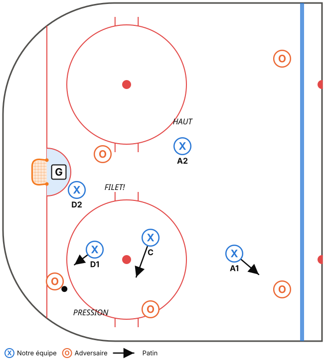

- **D1** : PRESSION sur le porteur dans le coin.
- **D2** : FILET, toujours.
- **C** : SOUTIEN bas, aide D1 (2e joueur en bas).
- **A1 (côté fort)** : couvre la POINTE du côté de la rondelle.
- **A2 (côté faible)** : HAUT DE L'ENCLAVE.

**4 règles :**
1. **Il y a toujours un D devant le filet.**
2. **Bâton sur la glace** : les 5 joueurs.
3. **Les ailiers ne descendent jamais sous les cercles.** Ils restent « hauts » pour la sortie.
4. Quand la rondelle change de côté, **A1 et A2 échangent leurs rôles** (le côté fort couvre la pointe).

### 2. Sortie de zone : « MUR – VITRE – PROFOND »

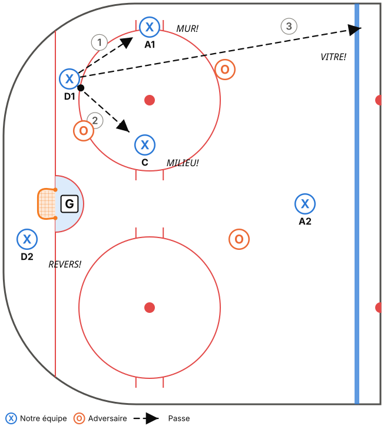

- **D1** : récupère la rondelle.
- **A1 (MUR)** : dos à la bande, à la hauteur des hachures.
- **C (MILIEU)** : bas, soutien court.
- **D2 (REVERS)** : de l'autre côté du filet.
- **A2** : au centre, près de la ligne bleue.

Ordre des options pour **D1** :
1. **MUR** : passe à l'ailier sur la bande (la plus sûre).
2. **MILIEU** : au centre, **seulement** s'il est complètement libre.
3. **VITRE** : sous pression, on sort la rondelle sur la vitre / le long de la bande. **Ce n'est pas un échec, c'est une réussite.**

Pour **l'ailier au MUR** qui reçoit sous pression : **on pousse la rondelle en zone neutre** (le long de la bande) et on patine. Il n'y a pas de feinte à faire.

### 3. Zone neutre et entrée : « ENTRE OU PROFOND »

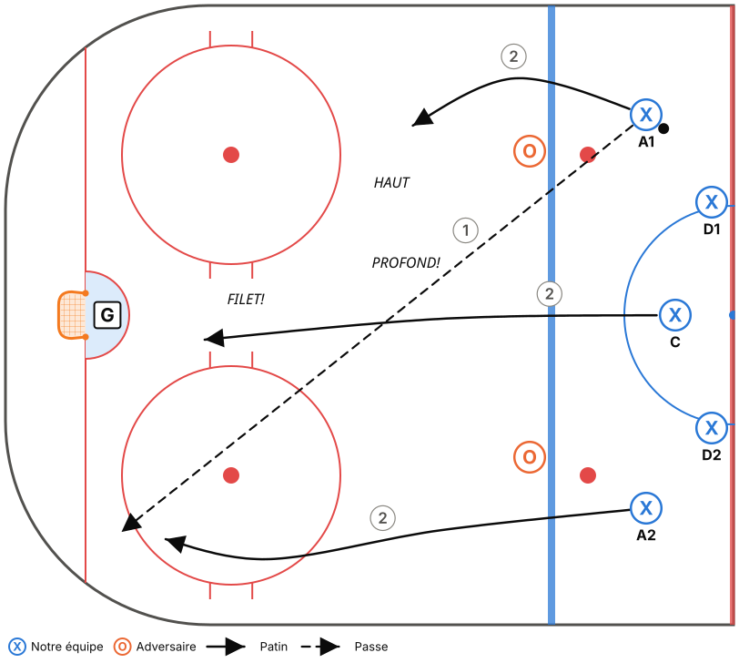

- **De la vitesse et de l'espace?** Entre en contrôle (« LARGE – FILET – HAUT » : porteur large, un au filet, un en retard).
- **Un D t'attend à la ligne bleue?** Envoie la rondelle **PROFOND**, dans le coin **opposé au gardien** (loin de lui).
- **Le 1er avant** poursuit la rondelle, **le 2e** va au **filet**, **le 3e** reste **haut** (au-dessus des cercles).
- **But principal :** **ne jamais perdre la rondelle à la ligne bleue adverse**. C'est ce qui cause les contre-attaques.

### 4. Zone offensive : « POINTE – BAS – FILET »

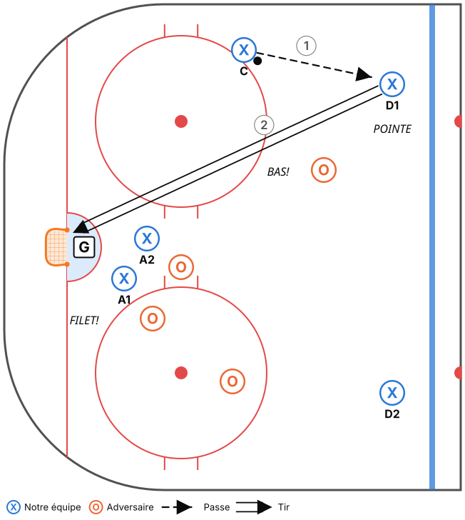

- Rondelle à la **pointe**, **tir bas**, **2 joueurs au filet** (écran et rebonds).
- Au niveau C, **la majorité des buts viennent des rebonds et des écrans**. C'est notre arme.

### 5. Échec avant 1-2-2 : « UN VA, DEUX LISENT, DEUX GARDENT »

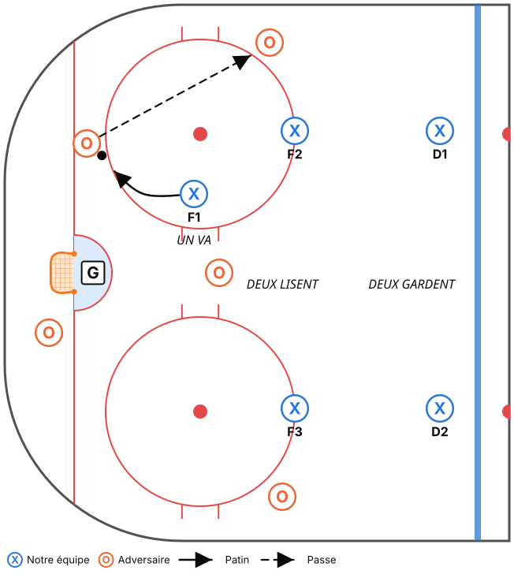

- **F1** force le porteur vers la bande.
- **F2 / F3** à la hauteur des cercles, un de chaque côté.
- **D1 / D2** à la ligne bleue. En cas de doute, **on recule** : c'est plus sécuritaire.

### 6. Repli : « MILIEU – TÊTE SUR L'ÉPAULE – HOMME »

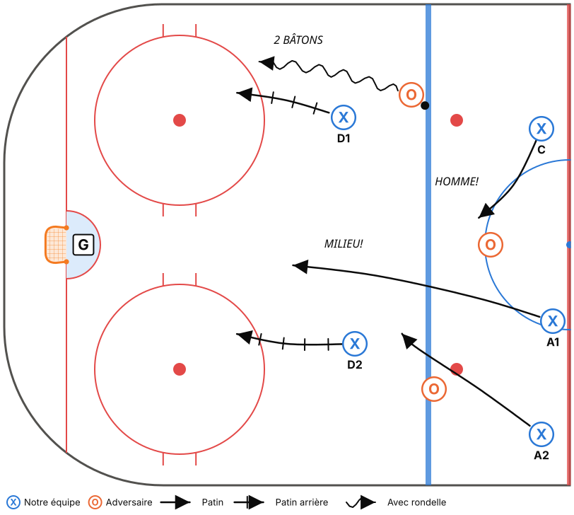

- Les avants reviennent **par le milieu**, regardent par-dessus leur épaule et prennent **un joueur sans rondelle**.
- Les D reculent en gardant un **écart de 2 bâtons** avec le porteur et le poussent vers la bande.

### 7. Mises au jeu (positions fixes, dès la phase 1)

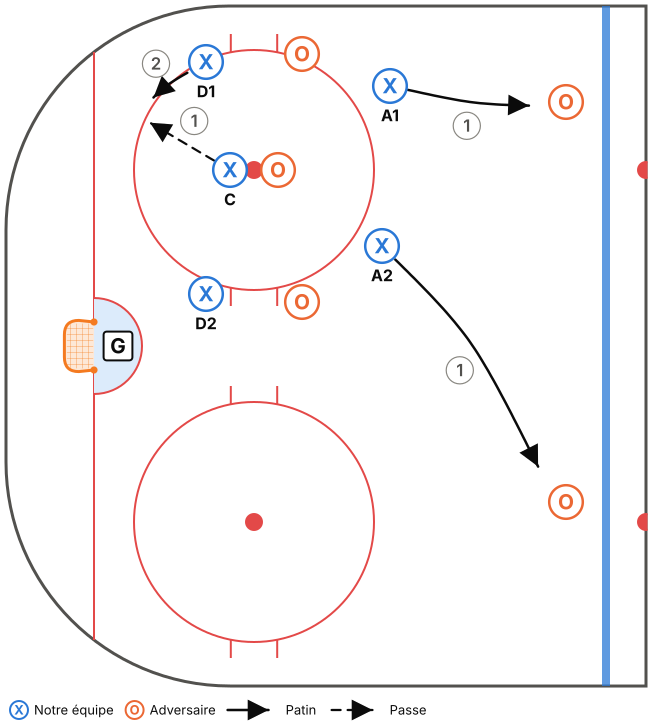

- **Zone défensive** : l'ailier côté bande prend la pointe adverse, l'autre ailier prend la 2e pointe, les D prennent les avants adverses. Le centre gagne la rondelle **vers l'arrière, dans le coin** vers son D.
- **Zone offensive** : le centre ramène la rondelle vers la pointe. Les 2 ailiers **vont au filet** immédiatement.

### Critères pour passer à la phase 2

- [ ] En match, **moins de 3 pertes de rondelle** par période à la ligne bleue adverse.
- [ ] Il y a toujours un D devant le filet en zone défensive (vérifier à la vidéo ou par un parent observateur).
- [ ] Les joueurs utilisent « VITRE! » et « PROFOND! » sans hésiter.
- [ ] Les positions aux mises au jeu sont automatiques.

---

## PHASE 2 – Plus d'options (déc. à fin jan.)

Les joueurs ont compris la structure et la technique s'est améliorée : **on ajoute des options, sans rien enlever.**

### Zone défensive : échange D-C

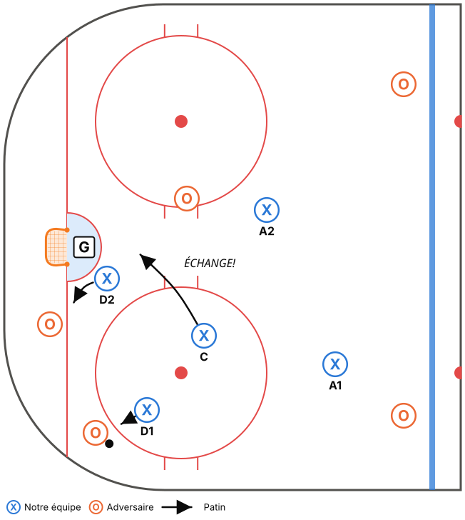

- Si **D2 doit quitter le filet** (2e adversaire dans le coin), **le centre prend le filet** (« ÉCHANGE! »).
- Principe général : **« Quelqu'un est TOUJOURS au filet. »** Le rôle ne dépend plus du numéro de position.

### Sortie de zone : « REVERS » et courbe du centre

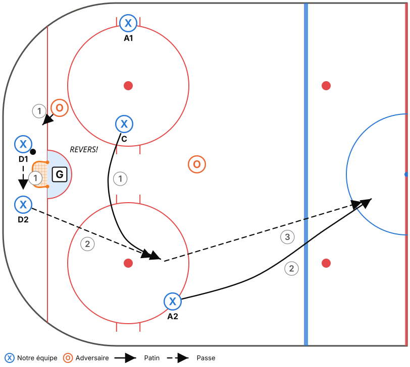

- **D1 → D2 derrière le filet** quand la pression vient du côté fort.
- **Le centre fait une courbe** vers le côté du D2 pour recevoir en mouvement.
- **L'ailier du côté faible** s'étire au centre, près de la ligne rouge (option longue quand l'adversaire change de joueurs).

### Zone neutre : regroupement

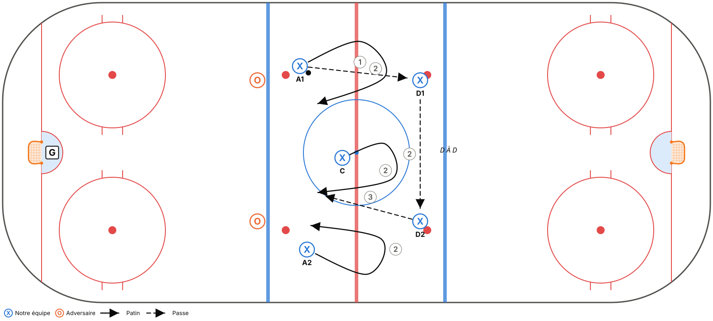

- Si l'entrée est bloquée, **remettre la rondelle au D**, qui fait un D à D. Les avants font des **courbes** et on relance l'attaque à pleine vitesse.

### Zone offensive : cycle bas

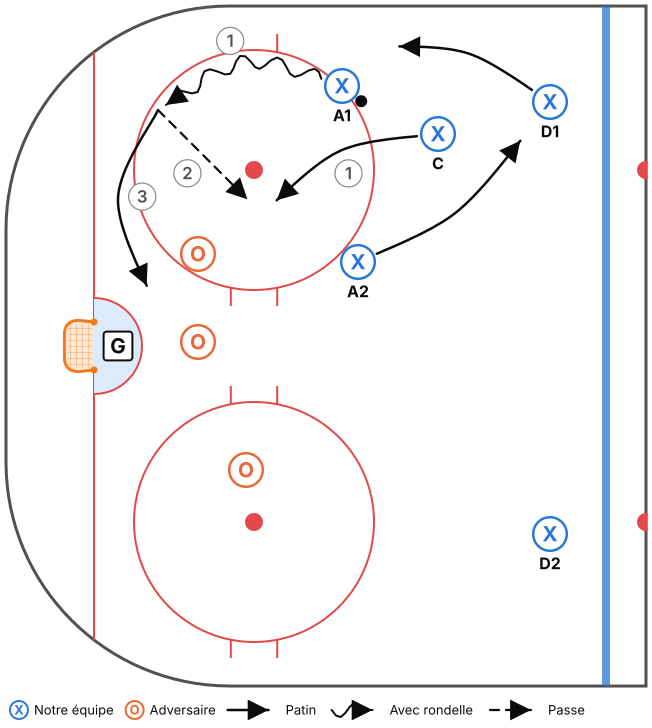

- Le porteur protège sa rondelle et descend dans le coin, puis **la remet au joueur qui le suit** et **va au filet**.
- Le D du côté fort peut **descendre à la ligne des hachures** si l'ailier haut prend sa place à la pointe.

### Échec avant : 2-1-2 (rondelle dans le coin adverse)

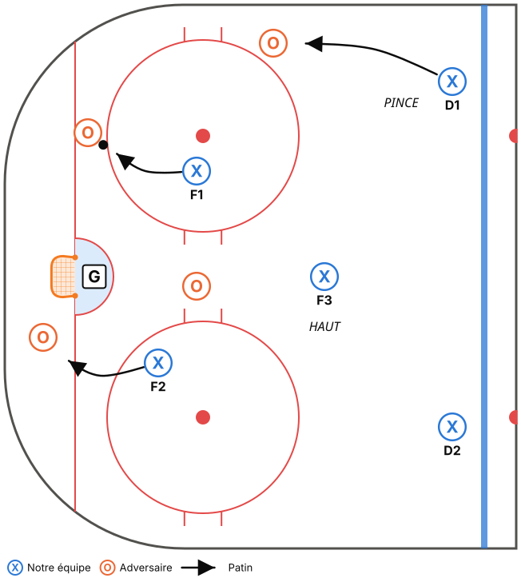

- **F1** prend le porteur, **F2** prend la 2e option (le D à D ou la bande).
- **F3 haut, au centre** : c'est la sécurité.
- **Les D** : le D du côté fort peut **pincer** sur la bande **seulement si F3 est haut**.
- Si l'adversaire sort de sa zone en contrôle, **on recule en 1-2-2 dans la zone neutre**.

### Unités spéciales

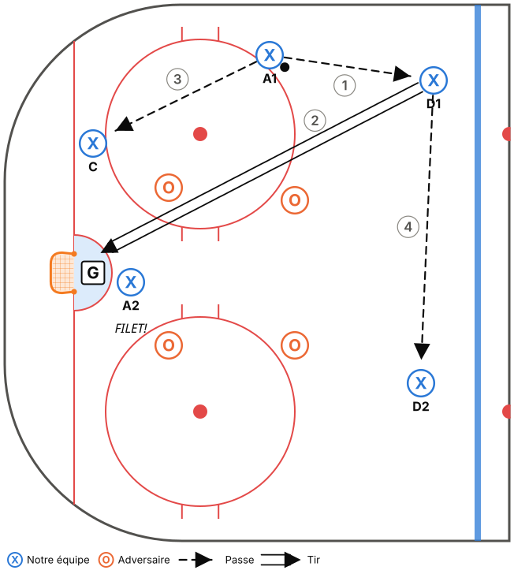

- **Désavantage numérique : la boîte.** Carré serré, bâtons dans les lignes de passe. Si on récupère la rondelle : **VITRE**, on la dégage.
- **Avantage numérique : la surcharge côté fort.** 3 joueurs en triangle du côté de la rondelle (bande, pointe, bas), 1 au filet et 1 à la pointe opposée. On met la rondelle au filet, on prend les rebonds.

### Critères pour passer à la phase 3

- [ ] La sortie par le « REVERS » est réussie au moins 1 fois sur 2 en pratique 5c2.
- [ ] Sur l'échec avant 2-1-2, F3 reste haut à chaque présence (pas de 2c1 contre nous).
- [ ] L'équipe fait au moins 4 tirs par avantage numérique.

---

## PHASE 3 – Gérer le match (fév. à mars)

- **Choisir l'échec avant selon la situation** : 2-1-2 quand on tire de l'arrière ou qu'on a de l'énergie, 1-2-2 quand on mène ou qu'on est fatigués. **Les joueurs l'annoncent au banc.**
- **Protéger une avance** : la rondelle profonde est obligatoire, aucune passe au centre en zone neutre, D prudents.
- **Contre-attaque** : dès qu'on récupère la rondelle en zone neutre, l'ailier du côté faible part vers la ligne bleue adverse.
- **Filet désert / gardien retiré** (fin de match) : positions de base apprises en pratique.
- **Lire l'adversaire** : le capitaine rapporte au banc comment l'adversaire sort de sa zone, et on ajuste l'échec avant.

---

## Comment enseigner chaque notion

1. **Tableau** (3 min) : situation, mots-clés et une question du genre : « Pourquoi on met la rondelle profond au lieu de forcer la ligne bleue? »
2. **5c0 au ralenti**, puis **5c0 à vitesse réelle**.
3. **Opposition progressive** : 5c2, 5c3, puis 5c5.
4. **Petit jeu à règle** : par ex., un but compte double après une rondelle profonde récupérée.
5. **Rappel technique ciblé** : on isole le geste qui a fait défaut (passe sur la bande, réception) et on le travaille dans le bloc technique de la pratique suivante.

> Ces joueurs apprennent vite : **ne restez pas trop longtemps en 5c0**. Passez à l'opposition dès que 80 % des joueurs ont compris.
